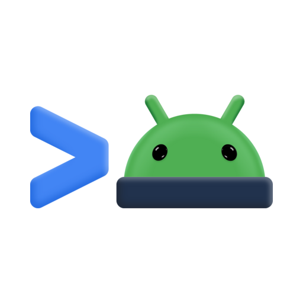

<p align="center">
  
</p>

# Android CLI

**Android CLI** is the official command-line interface that standardizes core Android development competencies for agent-first workflows. It gives coding agents and developers an entry point to the official tools, skills, and documentation needed to build for Android efficiently.

Whether you are scaffolding a new app, launching virtual devices, running fast incremental builds, inspecting live device layouts, or evaluating user journeys, the Android CLI streamlines development directly from your workspace.

---

## 🚀 Key Capabilities

### 🛠️ Project Scaffolding
- Initialize modern Android projects from official templates using `android create`.
- Pre-configured with the latest Android Gradle Plugin (AGP), Jetpack Compose, and best practices.
- Print environment information including SDK location, connected devices, and configuration variables using `android info` (use specific fields to narrow the output).

### 📱 Device & Emulator Management
- Inspect, create, and launch Android Virtual Devices (AVDs) directly from the terminal with `android emulator`.
- Deploy and launch applications with fast delta installs using `android run`.

### 🧠 Agent Skills Management
- The `android skills` command provides an official way to discover, install, update, and manage recommended skills.
- Skills installed using this command aren't removed if the Android plugin for Antigravity is uninstalled.

### 🔍 UI Layout Inspection & Screen Analysis
- Extract the live application layout tree in structured JSON using `android layout`.
- Inspect UI hierarchies, interactive bounds, accessibility attributes, and focus states.
- Capture device screenshots and resolve visual coordinates for automated interactions using `android screen`.

### 🧪 Journey Testing
- Test end-to-end user flows with Journey tests defined using natural language, using `android layout` and visual verification.
- Output structured Markdown reports detailing pass/fail statuses, ADB interaction commands, and verification screenshots.

### 📚 Official Android Knowledge Base
- Search authoritative, up-to-date Android developer documentation directly from the CLI via `android docs search "<query>"`.
- Fetch full articles and migration guides using `android docs fetch kb://...`.

### 🖥️ Device Hub & Compose Preview Panes
- **Android Device Hub**: list, start, stop, create, and remove Android Virtual Devices, and mirror and control emulators and physical devices connected to adb, in a side pane.
- **Android Compose Preview**: render Jetpack Compose `@Preview` functions with `android preview` and review the results in a side pane.
- Both panes are served by the Android CLI (`android sidecar run <name>`), which downloads their implementation on first use.

---

## 📦 Installation & Setup

If the `android` tool is not already in your `PATH`, install it using the platform-specific installer:

### Linux
```bash
curl -fsSL https://dl.google.com/android/cli/latest/linux_x86_64/install.sh | bash
```

### macOS (Apple Silicon)
```bash
curl -fsSL https://dl.google.com/android/cli/latest/darwin_arm64/install.sh | bash
```

### macOS (Intel)
```bash
curl -fsSL https://dl.google.com/android/cli/latest/darwin_x86_64/install.sh | bash
```

### Windows
```cmd
curl -fsSL https://dl.google.com/android/cli/latest/windows_x86_64/install.cmd -o "%TEMP%\i.cmd" && "%TEMP%\i.cmd"
```

### Initialize Android CLI
You must run `android init` for Antigravity to discover and use Android CLI:
```bash
android init
```
> [!NOTE]
> The skill installed by running this command isn't removed if the Android plugin for Antigravity is uninstalled.

### Update Android CLI
To keep your CLI and embedded skills up to date, run:
```bash
android update
```

---

## 💡 Starter Prompts

Once enabled, try asking your agent:

1. **Creating a new Android project**:
   > *"Create a new Android project called MyFirstApp using the empty-activity template"*

2. **Running on a device**:
   > *"Run my app on a Samsung Galaxy Ultra device."*

3. **Testing & Play readiness**:
   > *"Test my app and make sure that it's ready to publish to Google Play."*

---

## 📖 Command Reference

| Command | Description |
| :--- | :--- |
| `android create` | Initialize a new Android project from available templates. |
| `android describe` | Generate descriptive build target and artifact metadata for a project. |
| `android run` | Build, deploy, and launch an application on a connected device or emulator. |
| `android layout` | Returns the active UI layout tree in JSON format (supports `--pretty` and `--diff`). |
| `android screen` | Commands to view, capture, and target UI elements visually on device. |
| `android emulator` | Create, start, stop, and list Android Virtual Devices (AVDs). |
| `android sdk` | Manage Android SDK packages, platforms, and build tools. |
| `android docs` | Search and fetch documentation from the official Android Knowledge Base. |
| `android info` | Print environment information including SDK location, connected devices, and configuration variables. Use specific fields to narrow the output. |
| `android init` | Initialize the environment and install default Android CLI agent skills (skills that are installed aren't removed if the Android plugin for Antigravity is uninstalled). |
| `android skills` | Manage Android CLI skills (search, add, remove, list, update). Skills that are installed aren't removed if the Android plugin for Antigravity is uninstalled. |
| `android update` | Update the Android CLI to the latest version. |

---

For more documentation, visit [developer.android.com/tools/agents/android-cli](https://developer.android.com/tools/agents/android-cli).
